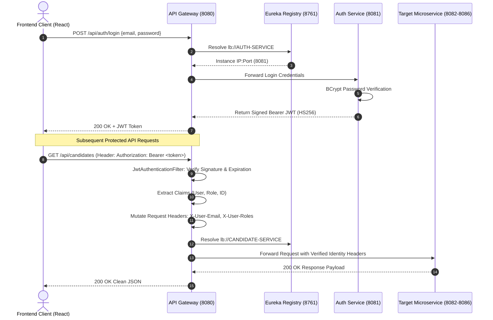

# Microservice Architecture & Service Discovery Specification

## 1. System Architecture Topology

The **TalentFlow** platform follows Service-Oriented Architecture (SOA) principles with clear bounded contexts, independent data stores, and standardized REST API contracts.

```
                                  +------------------------------+
                                  |    React 18 + Vite Frontend  |
                                  |   (Port 5173 / Tailwind UI)  |
                                  +--------------+---------------+
                                                 | HTTP / REST + Bearer JWT
                                                 v
                                  +------------------------------+
                                  |     Spring Cloud Gateway     |
                                  |   (Port 8080 / JWT Filter)   |
                                  +--------------+---------------+
                                                 |
                                                 v Service Discovery (Eureka Client)
                                  +------------------------------+
                                  |    Netflix Eureka Registry   |
                                  |   (EUREKA-SERVER Port 8761)  |
                                  +--------------+---------------+
                                                 |
     +-------------------+-------------------+---+-------------------+-------------------+-------------------+
     |                   |                   |                       |                   |                   |
     v                   v                   v                       v                   v                   v
+----------+       +-----------+       +-----------+           +-----------+       +-----------+       +-----------+
|   AUTH   |       | CANDIDATE |       |    JOB    |           |APPLICATION|       | PIPELINE  |       | INTERVIEW |
| SERVICE  |       |  SERVICE  |       |  SERVICE  |           |  SERVICE  |       |  SERVICE  |       |  SERVICE  |
|  (8081)  |       |  (8082)   |       |  (8083)   |           |  (8084)   |       |  (8085)   |       |  (8086)   |
+----------+       +-----------+       +-----------+           +-----------+       +-----------+       +-----------+
```

---

## 2. Microservice Identification & Port Registry

Each microservice registers dynamically with Netflix Eureka Service Registry on boot using `spring-cloud-starter-netflix-eureka-client` and `@EnableDiscoveryClient`.

| Service Name | Port | Primary Responsibility | Service Discovery Name | Protocol |
| :--- | :---: | :--- | :--- | :---: |
| **Eureka Registry** | `8761` | Dynamic Instance Registration & Heartbeat Health Monitor | `EUREKA-SERVER` | HTTP |
| **API Gateway** | `8080` | Reverse Proxy, Path Rewriting, Pre-flight CORS, JWT Pre-filtering | `API-GATEWAY` | HTTP |
| **Auth Service** | `8081` | User Governance, BCrypt Hashing, JWT Token Generation & Validation | `AUTH-SERVICE` | HTTP/REST |
| **Candidate Service** | `8082` | Candidate Profiles, Resumes, Experience & Skill Matrix | `CANDIDATE-SERVICE` | HTTP/REST |
| **Job Service** | `8083` | Requisitions, Headcounts, Department & Salary Specifications | `JOB-SERVICE` | HTTP/REST |
| **Application Service** | `8084` | Candidate-Job Applications & Duplicate Prevention (HTTP 409) | `APPLICATION-SERVICE` | HTTP/REST |
| **Pipeline Service** | `8085` | 7-Stage State Machine Orchestration & Immutable Stage Transition Log | `PIPELINE-SERVICE` | HTTP/REST |
| **Interview Service** | `8086` | Interview Scheduling, Virtual Meeting Links & 6-Competency Scorecards | `INTERVIEW-SERVICE` | HTTP/REST |
| **Notification Service** | `8087` | Platform Event Feed Alerts & In-app Notifications | `NOTIFICATION-SERVICE` | HTTP/REST |

---

## 3. JWT Security & API Gateway Pre-filter Flow



### Security Flow Details:
1. **Public Endpoints**: `/api/auth/login`, `/api/auth/register`, `/api/auth/validate`, and Eureka health endpoints bypass authentication checks.
2. **Token Inspection**: For all protected routes, `JwtAuthenticationFilter` validates the `Authorization: Bearer <token>` header.
3. **Identity Propagation**: Upon verification, the gateway injects trusted downstream headers (`X-User-Email`, `X-User-Roles`, `X-User-Id`), ensuring microservices receive authenticated identity without redundant re-verification.
4. **Negative Security Handling**:
   - Missing Authorization header &rarr; HTTP `401 Unauthorized`.
   - Tampered/invalid signature &rarr; HTTP `401 Unauthorized`.
   - Role permission mismatch &rarr; HTTP `403 Forbidden`.

---

## 4. Inter-Service Communication & Data Isolation

- **Zero Database Sharing**: Each microservice maintains its dedicated in-memory H2 database. Microservices never perform cross-database queries or foreign-key constraints across service boundaries.
- **Loose Coupling**: Services communicate via standardized REST interfaces through the Gateway or direct Feign/RestTemplate clients.
- **Data Synchronization**: When a stage transition occurs in the Pipeline Service:
  - Pipeline Service records the stage change and transition remarks in `pipeline_history`.
  - Application Service status is updated via `PATCH /api/applications/:id/status`.
  - Candidate Service status is synchronized via `PATCH /api/candidates/:id/status`.
